# Topological Sorting using BFS - Kahn's Algorithm

[source](https://www.geeksforgeeks.org/dsa/topological-sorting-indegree-based-solution/)

Given a Directed Acyclic Graph having V vertices and E edges, find any Topological Sorted ordering of the graph.

Topological Order is a linear ordering of vertices such that for every directed edge u -> v, vertex u comes before v in the ordering.

**Example:**

**Input:** `adj[][] = [[1], [2], [], [2, 4], []]`
**Output:** `[0, 3, 1, 4, 2]`
**Explanation:** For every pair of vertex(u -> v) in the ordering, u comes before v.

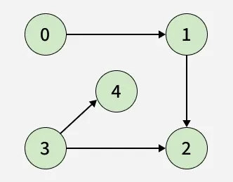

**Input:** `adj[][]= [[1], [2], [3], [], [5], [1, 2]]`
**Output:** `[0, 4, 5, 1, 2, 3]`
**Explanation:** For every pair of vertex(u -> v) in the ordering, u comes before v.

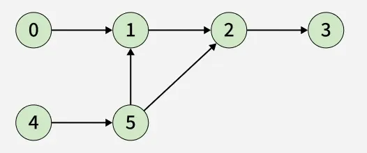

Try It Yourself

The Kahn’s Algorithm uses BFS and has the following steps.

- Compute in-degree of every vertex — representing how many incoming edges each vertex has.
- Add all vertices with an in-degree of 0 a queue, as they can appear first in the topological ordering.
- Repeatedly remove a vertex from the queue, add it to result, and reduce in-degree of all its adjacent. If any of those vertices now have an in-degree of 0, add them also to the queue.
- This process continues until the queue is empty

**Illustration of the algorithm:**

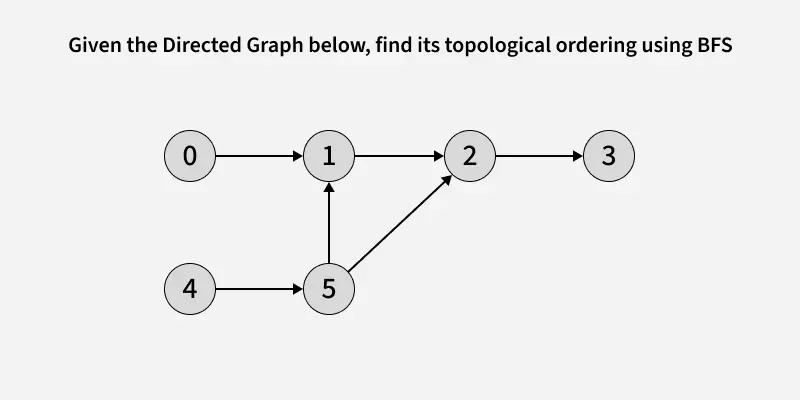

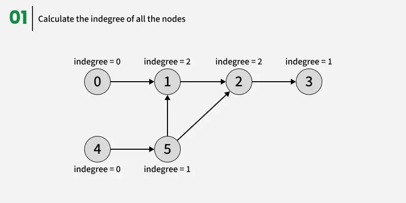

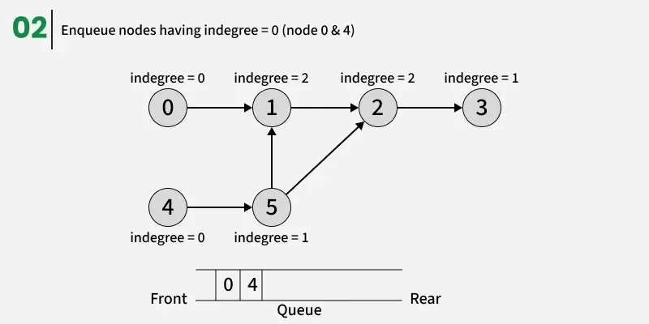

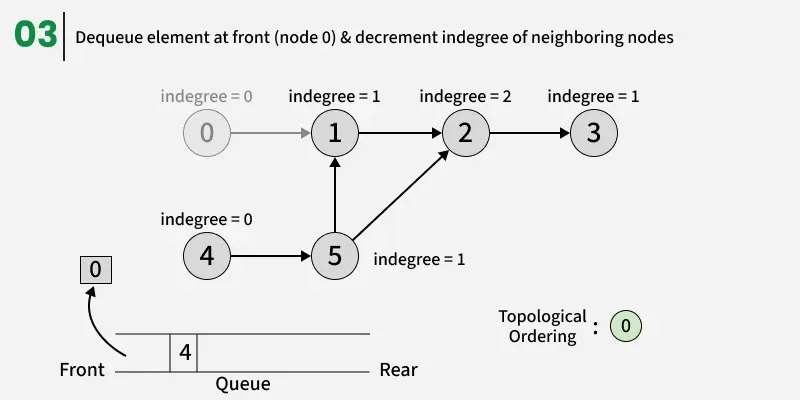

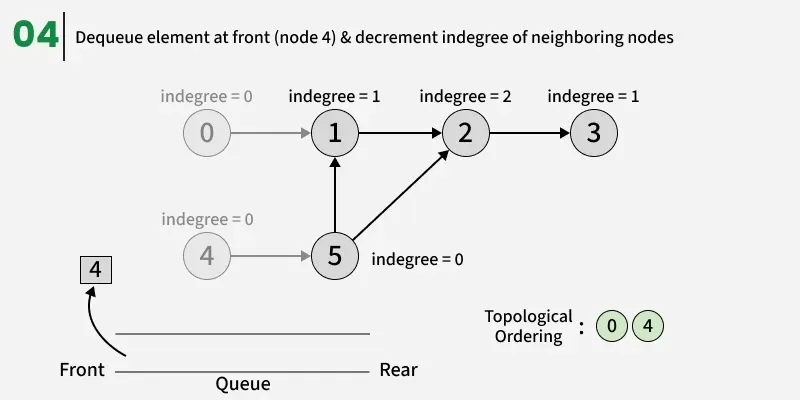

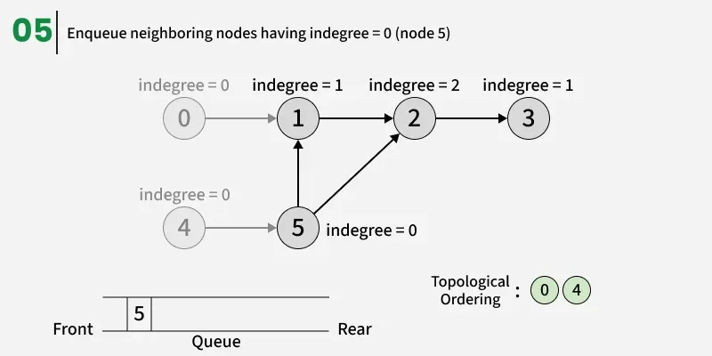

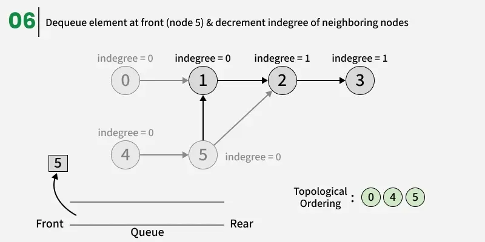

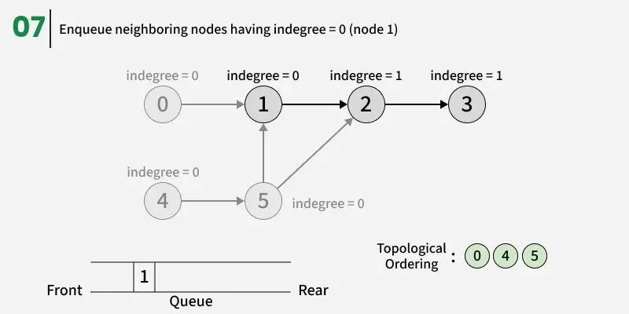

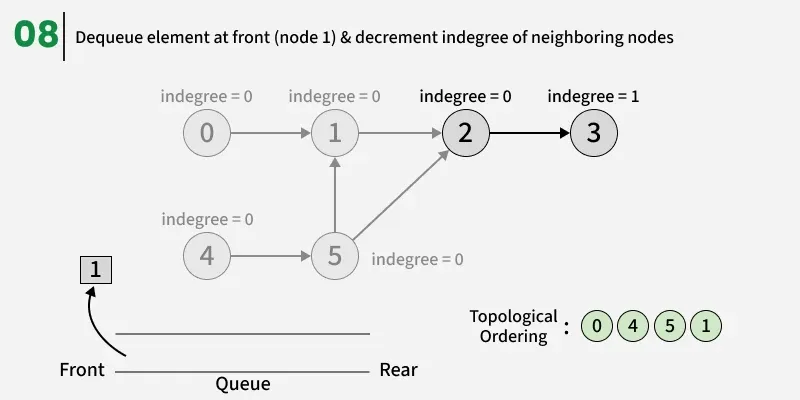

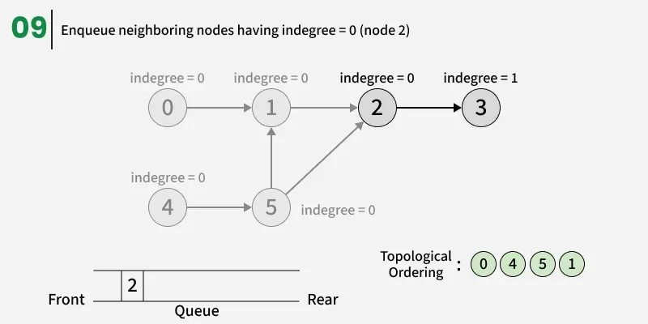

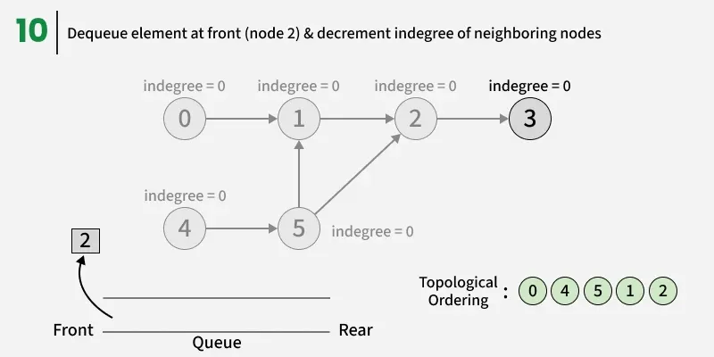

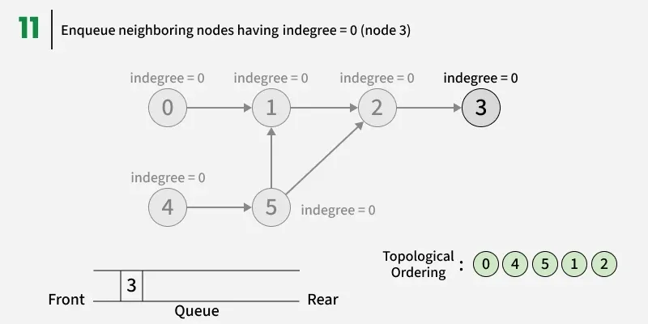

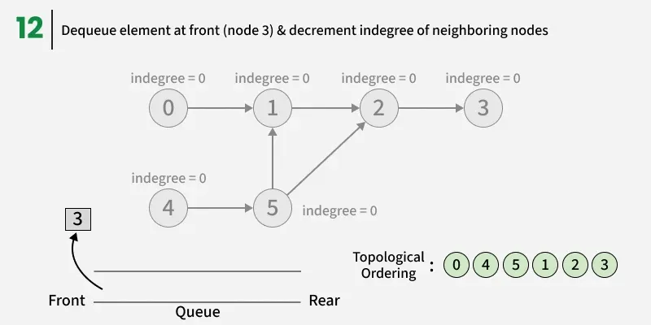

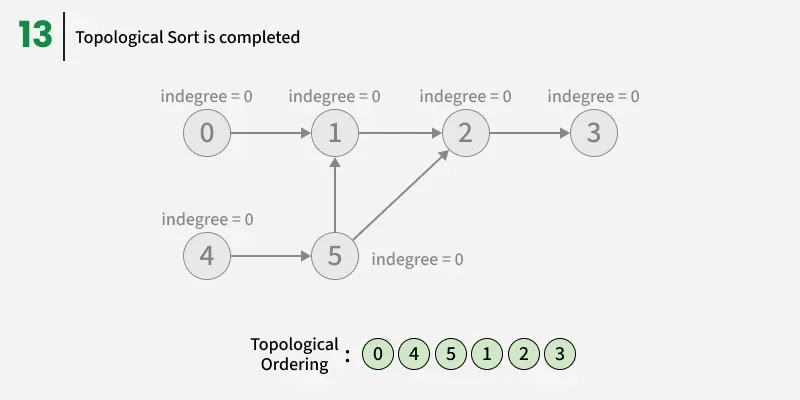

Below is the implementation of the above algorithm.

### Python

```python
#Driver Code Starts
from collections import deque
#Driver Code Ends

def topoSort(adj):
    n = len(adj)
    indegree = [0] * n
    res = []
    queue = deque()

    # Compute indegrees
    for i in range(n):
        for next_node in adj[i]:
            indegree[next_node] += 1

    # Add all nodes with indegree 0
    # into the queue
    for i in range(n):
        if indegree[i] == 0:
            queue.append(i)

    # Kahn’s Algorithm
    while queue:
        top = queue.popleft()
        res.append(top)
        for next_node in adj[top]:
            indegree[next_node] -= 1
            if indegree[next_node] == 0:
                queue.append(next_node)
    return res

def addEdge(adj, u, v):
    adj[u].append(v)

#Driver Code Starts
# Example
n = 6
adj = [[] for _ in range(n)]
addEdge(adj, 0, 1)
addEdge(adj, 1, 2)
addEdge(adj, 2, 3)
addEdge(adj, 4, 5)
addEdge(adj, 5, 1)
addEdge(adj, 5, 2)
res = topoSort(adj)
print(*res)
#Driver Code Ends
```


**Output:**
`0 4 5 1 2 3`

**Time Complexity:** O(V+E). For Performing BFS.
**Auxiliary Space:** O(V).

