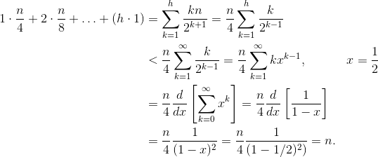

## Which implementation for `buildHeap` is more efficient?

[ source ](https://stackoverflow.com/questions/9755721/how-can-building-a-heap-be-on-time-complexity?__cf_chl_tk=JNhOmDKDJiBuqdsZXlAYWwELHDku_m16wCg.CT7IsxI-1794907896-1.0.1.1-VPiFMi3JS07RLlg8k4wUzH3Kd.YfzDhxDIsXw.bkovk)

Both of these solutions will produce a valid heap. Unsurprisingly, the more efficient one is the second operation that uses `siftDown`.

Let _h = log n_ represent the height of the heap. The work required for the `siftDown` approach is given by the sum

```
(0 * n/2) + (1 * n/4) + (2 * n/8) + ... + (h * 1).
```

Each term in the sum has the maximum distance a node at the given height will have to move (zero for the bottom layer, h for the root) multiplied by the number of nodes at that height. In contrast, the sum for calling `siftUp` on each node is

```
(h * n/2) + ((h-1) * n/4) + ((h-2)*n/8) + ... + (0 * 1).
```

It should be clear that the second sum is larger. The first term alone is _hn/2 = 1/2 n log n_, so this approach has complexity at best _O(n log n)_.

## How do we prove the sum for the `siftDown` approach is indeed _O(n)_?

One method (there are other analyses that also work) is to turn the finite sum into an infinite series and then use Taylor series. We may ignore the first term, which is zero:



If you aren't sure why each of those steps works, here is a justification for the process in words:

- The terms are all positive, so the finite sum must be smaller than the infinite sum.
- The series is equal to a power series evaluated at _x=1/2_.
- That power series is equal to (a constant times) the derivative of the Taylor series for _f(x)=1/(1-x)_.
- _x=1/2_ is within the interval of convergence of that Taylor series.
- Therefore, we can replace the Taylor series with _1/(1-x)_, differentiate, and evaluate to find the value of the infinite series.

Since the infinite sum is exactly _n_, we conclude that the finite sum is no larger, and is therefore, _O(n)_.

## Why does heap sort require _O(n log n)_ time?

If it is possible to run `buildHeap` in linear time, why does heap sort require _O(n log n)_ time? Well, heap sort consists of two stages. First, we call `buildHeap` on the array, which requires _O(n)_ time if implemented optimally. The next stage is to repeatedly delete the largest item in the heap and put it at the end of the array. Because we delete an item from the heap, there is always an open spot just after the end of the heap where we can store the item. So heap sort achieves a sorted order by successively removing the next largest item and putting it into the array starting at the last position and moving towards the front. It is the complexity of this last part that dominates in heap sort. The loop looks likes this:

```
for (i = n - 1; i > 0; i--) {
    arr[i] = deleteMax();
}
```

Clearly, the loop runs O(n) times (_n - 1_ to be precise, the last item is already in place). The complexity of `deleteMax` for a heap is _O(log n)_. It is typically implemented by removing the root (the largest item left in the heap) and replacing it with the last item in the heap, which is a leaf, and therefore one of the smallest items. This new root will almost certainly violate the heap property, so you have to call `siftDown` until you move it back into an acceptable position. This also has the effect of moving the next largest item up to the root. Notice that, in contrast to `buildHeap` where for most of the nodes we are calling `siftDown` from the bottom of the tree, we are now calling `siftDown` from the top of the tree on each iteration! _Although the tree is shrinking, it doesn't shrink fast enough_: The height of the tree stays constant until you have removed the first half of the nodes (when you clear out the bottom layer completely). Then for the next quarter, the height is _h - 1_. So the total work for this second stage is

```
h*n/2 + (h-1)*n/4 + ... + 0 * 1.
```

Notice the switch: now the zero work case corresponds to a single node and the _h_ work case corresponds to half the nodes. This sum is _O(n log n)_ just like the inefficient version of `buildHeap` that is implemented using siftUp. But in this case, we have no choice since we are trying to sort and we require the next largest item be removed next.

In summary, the work for heap sort is the sum of the two stages: _O(n) time for buildHeap and **O(n log n) to remove each node in order**, so the complexity is O(n log n)_. You can prove (using some ideas from information theory) that for a comparison-based sort, _O(n log n)_ is the best you could hope for anyway, so there's no reason to be disappointed by this or expect heap sort to achieve the O(n) time bound that `buildHeap` does.
