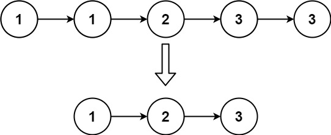

Easy

Given the `head` of a sorted linked list, _delete all duplicates such that each element appears only once_. Return _the linked list **sorted** as well_.

**Example 1:**

**Input:** head = [1,1,2]
**Output:** [1,2]

**Example 2:**

**Input:** head = [1,1,2,3,3]
**Output:** [1,2,3]

**Constraints:**

- The number of nodes in the list is in the range `[0, 300]`.
- `-100 <= Node.val <= 100`
- The list is guaranteed to be **sorted** in ascending order.
