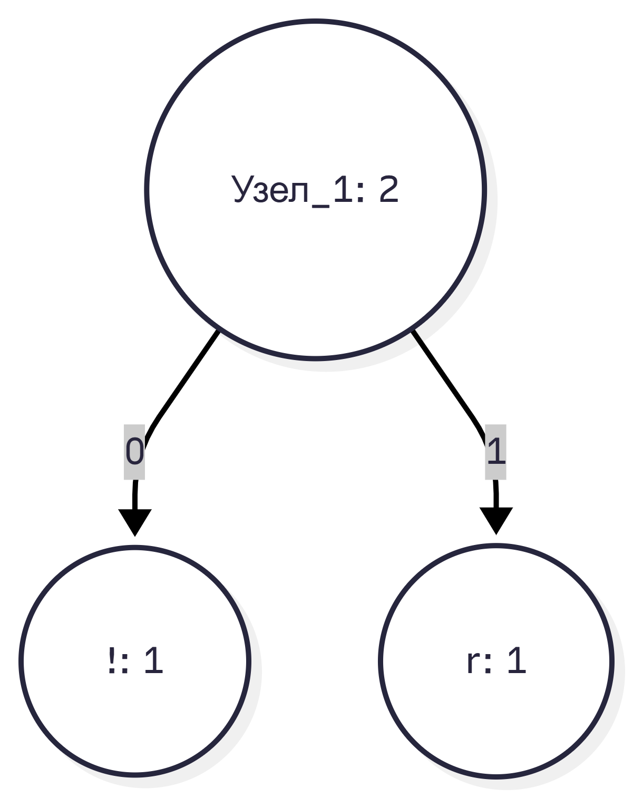
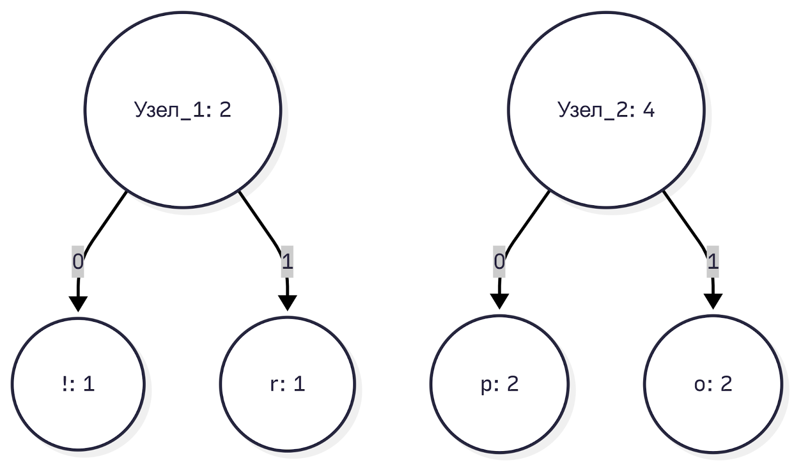
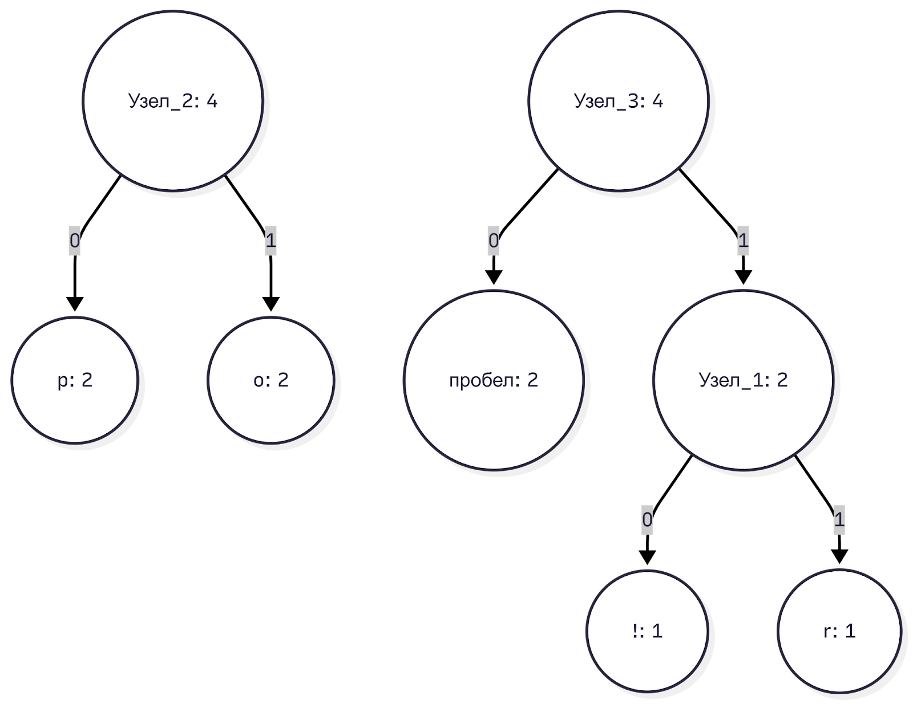
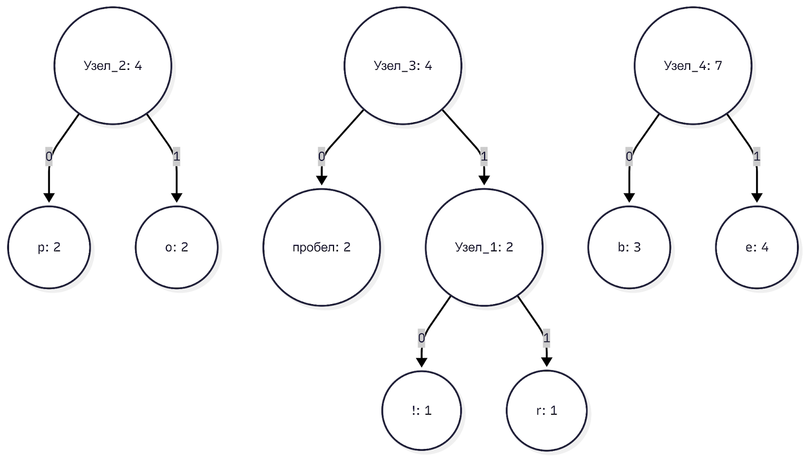
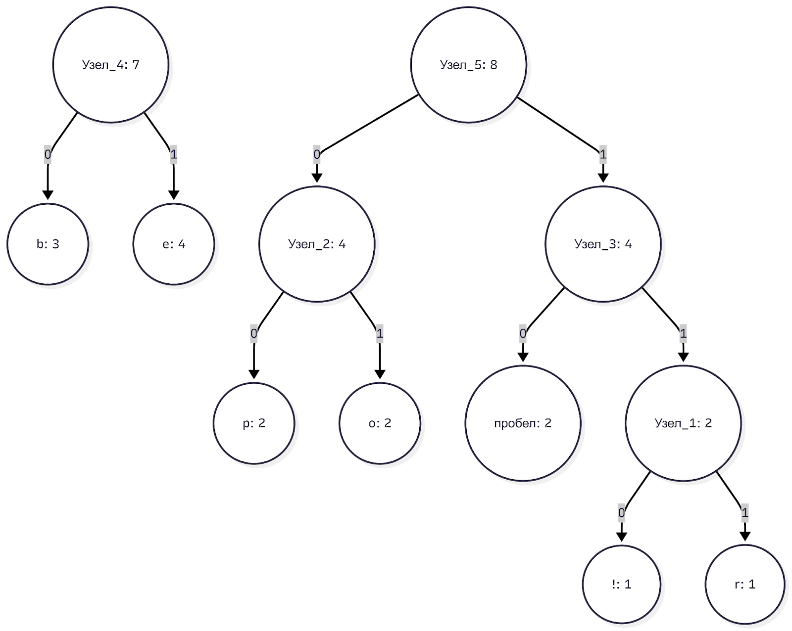
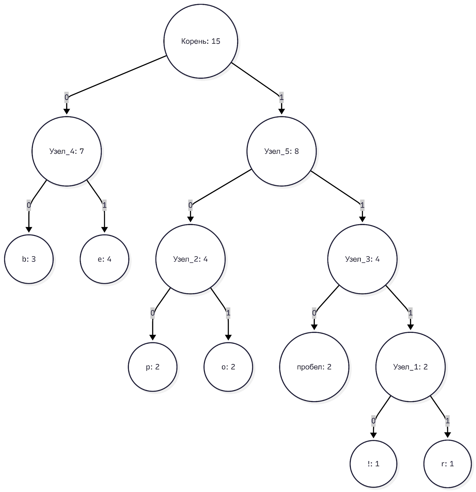
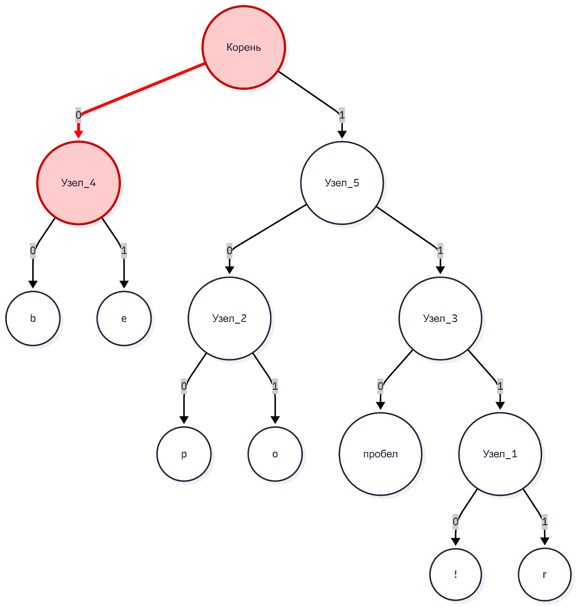
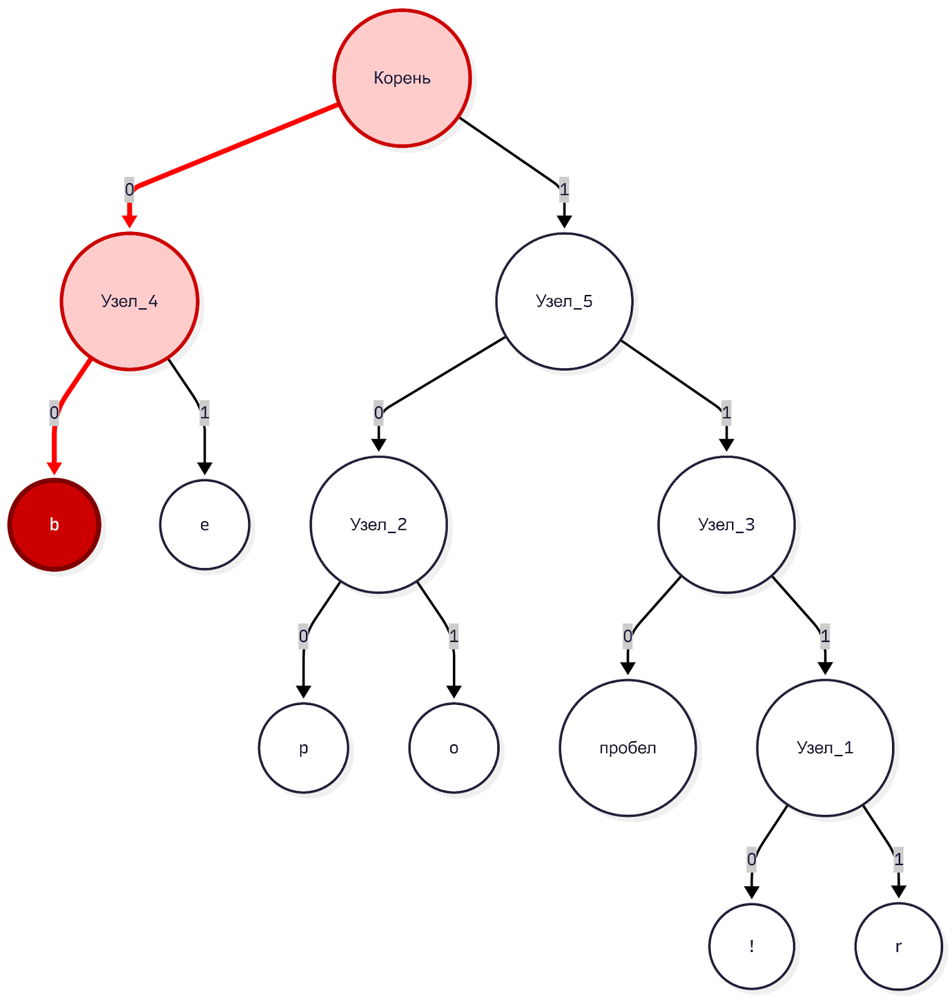
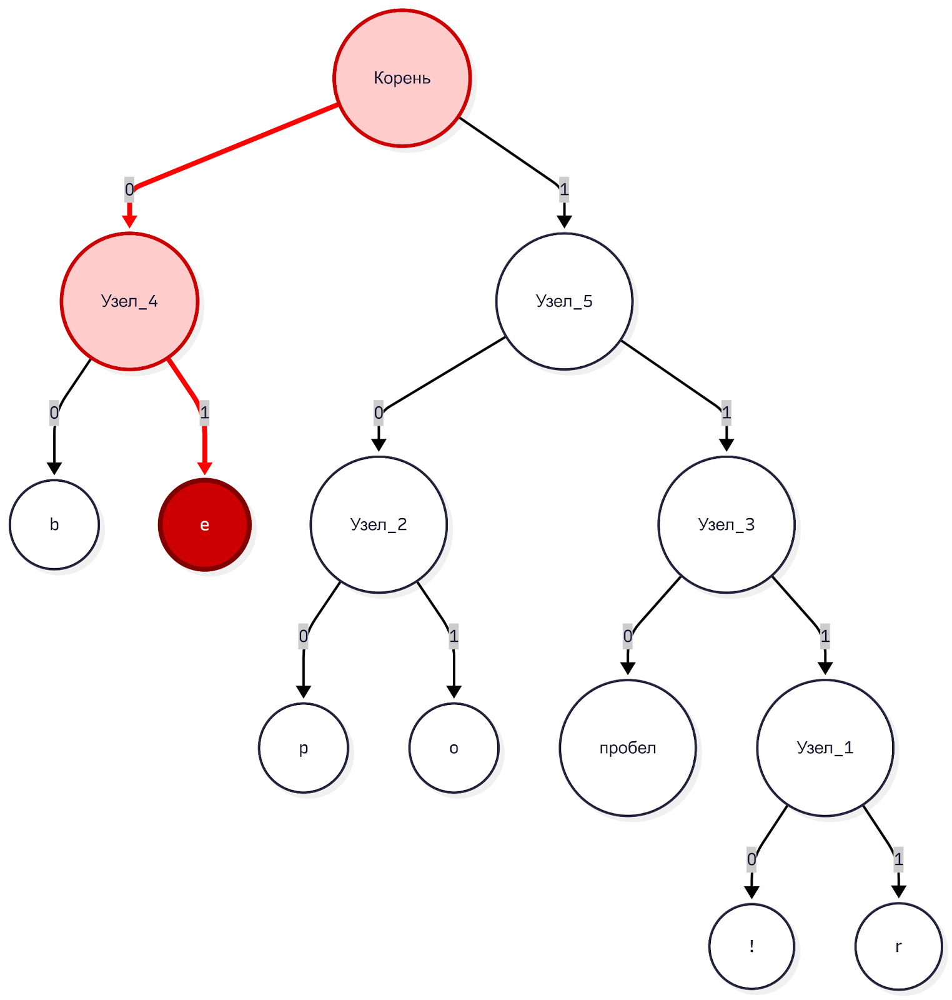

# Разбираем алгоритм сжатия Хаффмана

[Источник](https://thecode.media/algoritm-szhatiya-khaffmana/)
Каждый день мы отправляем гигабайты фотографий в мессенджерах, скачиваем программы, смотрим видео и читаем тексты в интернете. Чтобы сеть не рухнула от таких объёмов, а жесткие диски не переполнялись за пару дней, данные нужно сжимать.

Для сжатия данных используются специальные алгоритмы, и сегодня мы поговорим об одном из них — алгоритме сжатия Хаффмана. Это классический метод сжатия, который применяется во многих популярных форматах и изучается на большинстве базовых курсов по алгоритмам. Разберёмся, что представляет из себя метод. Посмотрим на работу алгоритма на понятном примере. Узнаем, где всё это используется на практике.

Содержание:

1. Что такое кодирование Хаффмана
2. Зачем нужно кодирование Хаффмана
3. Базовые понятия, чтобы разобраться с алгоритмом
4. Алгоритм кодирования Хаффмана шаг за шагом
5. Строим дерево кодирования Хаффмана
6. Как происходит декодирование кода Хаффмана
7. Почему код Хаффмана оптимален
8. Ограничения и вариации метода Хаффмана
9. Реализация алгоритма кодирования Хаффмана на практике
10. Частые ошибки при работе с алгоритмом Хаффмана
11. Бонус для читателей

## Что такое кодирование Хаффмана

Кодирование Хаффмана — это алгоритм, который использует оптимальный префиксный код для сжатия данных без потерь. Звучит запутанно, но на деле всё логично.

Главная идея метода Хаффмана заключается в следующем: часто встречающимся символам назначаются короткие коды, а редким — более длинные. За счёт этого средняя длина всего сообщения уменьшается, и файл начинает весить меньше. Похожий принцип работает в азбуке Морзе, где частая буква «Е» кодируется одной точкой, а редкая «Щ» — двумя тире и точкой.

Чтобы компьютер мог читать такие коды без пробелов и пауз, используется префиксный код. Это такое правило кодирования, при котором ни одно кодовое слово не является началом (или префиксом) другого. Благодаря этому свойству закодированное сообщение всегда однозначно декодируется компьютером: он никогда не перепутает, где заканчивается одна буква и начинается следующая.

Фан факт: метод придумал аспирант, чтобы получить «автомат» на экзамене. Студенту аспирантуры Массачусетского технологического института Дэвиду Хаффману в 1952 году задали курсовую на тему оптимального кодирования. Чтобы не сдавать сложный экзамен, Дэвид придумал алгоритм, который оказался эффективнее всех существовавших на тот момент методов.

## Зачем нужно кодирование Хаффмана

Компьютер не понимает букв, он понимает только нули и единицы. Обычно для хранения одного символа текста используется фиксированная битовая последовательность — 8 бит. Например, английская буква «A» кодируется как 01000001, а буква «B» — как 01000010.

Но представьте, что вы написали книгу, в которой буква «О» встречается миллион раз, а буква «Ф» — всего десять. Тратить на них одинаковое количество памяти (по 8 бит) — расточительство. Если мы дадим букве «О» код из 2 бит, а букве «Ф» — код из 12 бит, то в среднем на каждую букву мы потратим намного меньше памяти, чем стандартные 8 бит. В этом и заключается суть экономии места.

Где это применяется в реальном мире:

- **Архивирование данных:** форматы ZIP, GZIP, RAR используют метод Хаффмана как финальный этап сжатия текста и файлов.
- **Кодирование изображений и звука:** в форматах JPEG, PNG и MP3 этот алгоритм помогает дополнительно ужать данные после математических преобразований.
- **Стриминг видео и ускорение интернета:** популярные видеокодеки и даже современный сетевой протокол HTTP/2 используют кодирование Хаффмана на этапе передачи данных. Это экономит трафик провайдерам и позволяет страницам загружаться быстрее, а видео — воспроизводиться без задержек.

## Базовые понятия, чтобы разобраться с алгоритмом

Прежде чем мы начнём сжимать данные, давайте договоримся о терминах. Кодирование информации по Хаффману опирается на несколько простых понятий.

**Алфавит** — это набор всех уникальных символов, которые есть в нашем сообщении. Если мы сжимаем слово «АББА», наш алфавит состоит всего из двух букв — «А» и «Б».

**Частота символов** — это количество раз, которое конкретный символ встречается в тексте. В слове «АББА» частота буквы «А» равна 2, а частота «Б» — тоже 2.

**Двоичное дерево** — это структура данных, похожая на перевёрнутое дерево. У него есть один «корень» сверху, от которого вниз идут ветки. Каждая точка ветвления (узел) может иметь не более двух потомков (левого и правого). Самые нижние узлы, у которых нет потомков, называются «листьями».

**Дерево кодирования Хаффмана** — это специальное двоичное дерево, где каждый лист соответствует символу из нашего алфавита.

**Кодовое слово** — это последовательность из нулей и единиц, которая получается, если пройти по дереву от корня до нужного листа.

## Алгоритм кодирования Хаффмана шаг за шагом

Алгоритм кодирования Хаффмана — это классический жадный алгоритм. «Жадным» он называется потому, что на каждом шаге принимает локально самое выгодное решение (берёт элементы с наименьшей частотой), и в итоге это приводит к глобально оптимальному результату.

Вот как выглядит этот процесс по шагам:

1. Подсчитать частоты (или вероятности) появления каждого символа в сообщении.
2. Для каждого уникального символа создать вершину (лист) дерева. Вес этой вершины равен частоте появления символа.
3. Поместить все созданные вершины в приоритетную очередь (часто её реализуют через структуру данных min-heap). Очередь сама сортирует элементы так, чтобы на выходе всегда отдавать элементы с наименьшим весом.
4. Пока в очереди находится более одной вершины, необходимо выполнять следующие действия:  
   — извлечь две вершины с наименьшим весом;  
   — создать новую внутреннюю вершину, вес которой будет равен сумме весов этих двух извлечённых вершин;  
   — сделать извлечённые вершины левым и правым потомками новой внутренней вершины;  
   — поместить эту новую вершину обратно в приоритетную очередь.
5. Когда в очереди останется только одна вершина, алгоритм завершается. Эта оставшаяся вершина — корень дерева кодирования Хаффмана.
6. Теперь нужно обойти дерево и назначить коды. Договариваемся о правиле: переход к левому потомку — это бит «0», а переход к правому — бит «1». Код каждого символа — это последовательность нулей и единиц на пути от корня к листу с этим символом.

В итоге мы получаем оптимальное кодирование Хаффмана — словарь, в котором средняя длина кодовых слов будет минимально возможной для данного текста.

## Строим дерево кодирования Хаффмана

Попрактикуемся — возьмём фразу _«beep boop beer!»_ и разберём на ней работу кода Хаффмана.

Сначала посчитаем частоту каждого символа (всего у нас 15 символов, включая пробелы):

e — 4 раза,  
b — 3 раза,  
p — 2 раза,  
o — 2 раза,  
(пробел) — 2 раза,  
! — 1 раз,  
r — 1 раз

### Шаг 1

Берём два узла с минимальными частотами: «!» (1) и «r» (1). Объединяем их в узел_1 с весом 2.



### Шаг 2

Из оставшихся свободных узлов минимальные — это «p» (2) и «o» (2). Объединяем их в новый узел_2 с весом 4. Узел_1 пока просто ждёт своей очереди.



### Шаг 3

Теперь в пуле свободными остались e (4), b (3), пробел (2), узел_1(2) и узел_2(4).

Минимальные здесь — пробел (2) и узел_1 (2). Объединяем их в узел_3 с весом 4. Дерево начинает расти в глубину.



### Шаг 4

В пуле: e (4), b (3), узел_2(4), узел_3(4).

Минимальные значения у оставшихся одиночных букв: «b» (3) и «e» (4). Объединяем их в узел_4 с весом 7. У нас получается три независимых поддерева.



### Шаг 5

Остались только составные узлы: узел_4(7), узел_2(4), и узел_3(4).

Берём два самых лёгких: узел_2 (4) и узел_3 (4). Соединяем их в массивный узел_5 с весом 8.



### Шаг 6

В очереди осталось всего две ветки: узел_4 (7) и узел_5 (8).

Связываем их вместе и получаем корень с весом 15. Алгоритм завершён, мы получили единое и оптимальное кодовое дерево Хаффмана.



Теперь пройдём от корня к листьям и запишем коды: лево — 0, право — 1:

|              |             |                  |                |
| ------------ | ----------- | ---------------- | -------------- |
| **Символ**   | **Частота** | **Код Хаффмана** | **Длина кода** |
| **b**        | 3           | 00               | 2 бита         |
| **e**        | 4           | 01               | 2 бита         |
| **p**        | 2           | 100              | 3 бита         |
| **o**        | 2           | 101              | 3 бита         |
| **(пробел)** | 2           | 110              | 3 бита         |
| **!**        | 1           | 1110             | 4 бита         |
| **r**        | 1           | 1111             | 4 бита         |

Посчитаем выгоду. Если бы мы использовали стандартную кодировку по 8 бит на символ, строка из 15 символов заняла бы: 15 × 8 = 120 бит.

А теперь посчитаем длину закодированной строки:

(3 шт × 2 бита) + (4 шт × 2 бита) + (2 шт × 3 бита) + (2 шт × 3 бита) + (2 шт × 3 бита) + (1 шт × 4 бита) + (1 шт × 4 бита) = 6 + 8 + 6 + 6 + 6 + 4 + 4 = 40 бит.

Мы сжали фразу в 3 раза без малейших потерь качества! Исходная строка «beep boop beer!» превратится в такую битовую последовательность:

1.0110011000101102e+35.

**Полезный блок со скидкой**

Если вам интересно писать код и вы хотите разобраться, какой язык программирования выбрать для старта, — держите промокод Практикума на любой платный курс: [**KOD**](https://practicum.yandex.ru/promocode/?utm_source=content&utm_medium=brandmedia&utm_campaign=kod_brandmedia_RF_common_Unde_b2c_Other_None_promocode-kod&code=KOD) (можно просто нажать). Он даст скидку при покупке и позволит сэкономить на обучении.

Бесплатные курсы в Практикуме тоже есть — по всем специальностям и направлениям. Начать можно в любой момент, карту привязывать не нужно.

## Как происходит декодирование кода Хаффмана

Сжать данные — это половина дела. Нам нужно уметь их распаковывать. Декодирование здесь происходит на удивление просто, и всё благодаря префиксности.

Представьте, что компьютер получает поток битов из нашего примера: 000101100… и имеет в распоряжении словарь — наше дерево. Он встаёт в корень дерева и читает первый бит.



Бит 0. Компьютер идёт по левой ветке. Это не лист, идём дальше.



Следующий бит 0. Компьютер снова идёт по левой ветке. Опа, это лист! В листе лежит буква «b». Компьютер записывает «b» и возвращается в корень дерева.


Следующий бит 0. Снова левая ветка.



Следующий бит 1. Правая ветка. Лист! Это буква «e». Записываем «e», возвращаемся в корень.

И так далее. Так как ни один код не является началом другого, алгоритм никогда не запутается. Ему не нужны символы-разделители. Как только он упёрся в конец ветки, он точно знает, что буква закончилась.

## Почему код Хаффмана оптимален

Когда программисты говорят, что метод Хаффмана даёт «оптимальную длину кода», они имеют в виду математически доказанный факт: для заданного текста и заданных частот символов невозможно придумать префиксный код, который сожмёт этот текст сильнее.

Доказательство этого факта основано на жадном выборе. Алгоритм на каждом этапе принимает очевидно правильное решение — он берёт два самых редких символа и объединяет их. Интуитивно это понятно: мы стараемся, чтобы самые частые символы (как буква «e» в нашем примере) находились как можно ближе к корню дерева (у них будет самый короткий путь и код), а самые редкие (как «!») задвигаются в самую глубину дерева.

Конечно, если частоты символов изменятся, наше текущее дерево перестанет быть оптимальным. Но для конкретного распределения частот этот алгоритм выдаёт математический максимум эффективности среди кодов, где один символ кодируется целым числом бит.

## Ограничения и вариации метода Хаффмана

Несмотря на всю красоту алгоритма, у него есть два недостатка: издержки на хранение словаря и ограничение целыми битами.

**Издержки на хранение словаря.** Чтобы расшифровать файл, архиватор должен приложить к файлу саму таблицу частот. Если вы сжимаете короткое сообщение в пару килобайт, размер словаря может оказаться больше, чем сэкономленное место.

**Ограничение целыми битами.** Алгоритм Хаффмана назначает каждому символу целое число бит (1, 2, 3 и т. д.). Но математика говорит, что иногда идеальный код для буквы должен составлять, например, 1.5 бита. Из-за этого метод проигрывает более сложному «арифметическому кодированию», которое умеет кодировать символы дробными долями бит.

Чтобы обойти эти ограничения, инженеры придумали вариации алгоритма. Например, существует адаптивное кодирование Хаффмана, где дерево перестраивается прямо на лету во время чтения файла, чтобы не нужно было передавать его.

## Реализация алгоритма кодирования Хаффмана на практике

Мы не будем писать полноценный архиватор, но соберём типовую структуру реализации этого алгоритма. Чтобы написать свой сжиматель, вам понадобится:

1. Хранить символ и его частоту в специальном объекте-узле.
2. Использовать приоритетную очередь для быстрого выбора двух узлов с минимальными частотами.
3. Написать рекурсивный обход построенного дерева для генерации словаря кодов.

Будем работать с Java. Если этот язык вам не знаком, не беда — в коде будут комментарии с обозначением типовых конструкций: циклов, словарей, очередей и т. д. В большинстве языков программирования эти конструкции тоже есть.

```java
// импортируем класс для работы со словарями (хэш-таблицами)
import java.util.HashMap;
// импортируем базовый интерфейс для работы с картами
import java.util.Map;
// импортируем класс для работы с приоритетной очередью
import java.util.PriorityQueue;

// создаём класс для представления узла дерева, он должен уметь сравниваться с другими узлами
class Node implements Comparable<Node> {
    // объявляем переменную для хранения символа (используем класс-обёртку, чтобы хранить null для внутренних узлов)
    Character ch;
    // объявляем переменную для хранения частоты символа
    Integer freq;
    // объявляем ссылки на левого и правого потомка
    Node left, right;

    // создаём конструктор для листового узла (когда у нас есть конкретный символ)
    public Node(Character ch, Integer freq) {
        // сохраняем символ
        this.ch = ch;
        // сохраняем частоту
        this.freq = freq;
    }

    // создаём конструктор для внутреннего узла (когда символа нет, но есть два потомка)
    public Node(Character ch, Integer freq, Node left, Node right) {
        // сохраняем символ (здесь будет null)
        this.ch = ch;
        // сохраняем суммарную частоту
        this.freq = freq;
        // сохраняем ссылку на левого потомка
        this.left = left;
        // сохраняем ссылку на правого потомка
        this.right = right;
    }

    // переопределяем метод для сравнения узлов между собой (нужно для приоритетной очереди)
    @Override
    public int compareTo(Node other) {
        // сравниваем узлы по их частоте (весу), чтобы очередь выдавала минимальные элементы первыми
        return this.freq - other.freq;
    }
}

// объявляем главный класс нашей программы
public class Huffman {

    // создаём метод для рекурсивного обхода дерева и генерации битовых кодов
    public static void generateCodes(Node node, String currentCode, Map<Character, String> codes) {
        // если мы упёрлись в пустоту (дошли до конца ветки)
        if (node == null) {
            // прерываем выполнение метода
            return;
        }

        // если у узла есть символ (значит, это лист дерева)
        if (node.ch != null) {
            // кладём в словарь-результат символ и его сгенерированный бинарный код
            codes.put(node.ch, currentCode);
        }

        // рекурсивно идём в левого потомка, добавляя к текущему коду "0"
        generateCodes(node.left, currentCode + "0", codes);
        // рекурсивно идём в правого потомка, добавляя к текущему коду "1"
        generateCodes(node.right, currentCode + "1", codes);
    }

    // главный метод программы, отсюда всё запускается
    public static void main(String[] args) {
        // задаём тестовую строку, которую будем сжимать
        String text = "beep boop beer!";

        // создаём словарь для подсчёта частоты каждого символа
        Map<Character, Integer> freqMap = new HashMap<>();
        // разбиваем строку на массив символов и проходим по нему циклом
        for (char c : text.toCharArray()) {
            // увеличиваем счетчик для символа или ставим 1, если он встретился впервые
            freqMap.put(c, freqMap.getOrDefault(c, 0) + 1);
        }

        // создаём приоритетную очередь для хранения узлов дерева
        PriorityQueue<Node> pq = new PriorityQueue<>();

        // проходим циклом по всем записям в словаре частот
        for (Map.Entry<Character, Integer> entry : freqMap.entrySet()) {
            // создаём новый узел для каждого уникального символа и сразу добавляем его в очередь
            pq.add(new Node(entry.getKey(), entry.getValue()));
        }

        // запускаем цикл, пока в очереди не останется только один элемент (корень)
        while (pq.size() > 1) {
            // извлекаем из очереди узел с минимальной частотой (он станет левым потомком)
            Node left = pq.poll();
            // извлекаем следующий узел с минимальной частотой (он станет правым потомком)
            Node right = pq.poll();

            // считаем общую частоту для нового объединяющего узла
            int sumFreq = left.freq + right.freq;
            // создаём новый внутренний узел без символа (null), но с суммарной частотой и привязанными потомками
            Node mergedNode = new Node(null, sumFreq, left, right);

            // добавляем новый объединённый узел обратно в приоритетную очередь
            pq.add(mergedNode);
        }

        // извлекаем последний оставшийся узел в очереди -- это и есть корень нашего дерева
        Node root = pq.poll();

        // создаём пустой словарь для хранения итоговых кодов Хаффмана
        Map<Character, String> huffmanCodes = new HashMap<>();
        // запускаем генерацию кодов, начиная от корня с пустой строкой
        generateCodes(root, "", huffmanCodes);

        // выводим заголовок для результатов в консоль
        System.out.println("Символ | Код Хаффмана");
        // проходим циклом по всем сгенерированным кодам в словаре
        for (Map.Entry<Character, String> entry : huffmanCodes.entrySet()) {
            // выводим символ и его итоговый битовый код на экран
            System.out.println("'" + entry.getKey() + "'    | " + entry.getValue());
        }
    }
}
```

Java

Вывод будет таким:

```markdown
Символ | Код Хаффмана
' ' | 010
'p' | 011
'!' | 1010
'b' | 00
'r' | 1011
'e' | 11
'o' | 100
```

## Частые ошибки при работе с алгоритмом Хаффмана

Понять алгоритм в теории — это одно, а вот написать рабочий архиватор — совсем другое. Вот несколько ошибок, на которые вы можете наступить, если сядете писать свой архиватор.

**Забыть приложить словарь**. Если вы сожмёте текст, но не сохраните в архив таблицу частот, программа при распаковке не сможет заново построить дерево. Без него сжатые биты так и останутся нечитаемым цифровым мусором.

**Наплодить лишних символов в конце.** Компьютер пишет данные целыми байтами (по 8 бит). Если ваш сжатый код занимает 43 бита, система добьёт его нулями до 48 бит. При распаковке алгоритм прочитает эти пустые нули и превратит их в случайные буквы в конце текста. Решение — записывать в архив точную длину исходного файла.

**Сортировать на «авось».** Допустим, буквы «А» и «Б» встречаются по 5 раз. Если очередь будет выдавать их в случайном порядке, деревья при сжатии и распаковке получатся разными, и текст расшифруется с ошибками. Нужно строгое правило: например, при равной частоте всегда первой брать букву, которая стоит раньше по алфавиту.

**Сжимать то, что уже сжато.** Натравливать алгоритм на JPEG-фотографию или MP3-песню — плохая идея. Эти форматы уже сжаты (в том числе самим Хаффманом). В них почти стёрта разница между частыми и редкими символами. В итоге размер файла только увеличится из-за того, что к нему приклеится словарь.
