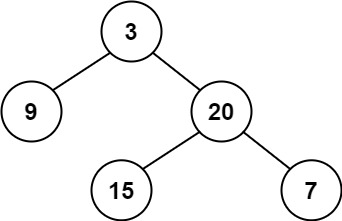
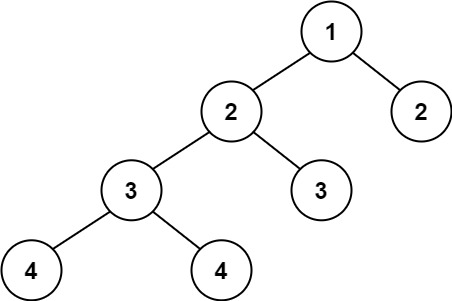

Easy

Given a binary tree, determine if it is **height-balanced**.

**Example 1:**

**Input:** root = [3,9,20,null,null,15,7]
**Output:** true

**Example 2:**

**Input:** root = [1,2,2,3,3,null,null,4,4]
**Output:** false

**Example 3:**

**Input:** root = []
**Output:** true

**Constraints:**

- The number of nodes in the tree is in the range `[0, 5000]`.
- `-10^4 <= Node.val <= 10^4`
