[Источник](https://www.geeksforgeeks.org/dsa/tree-traversals-inorder-preorder-and-postorder/)

---

# Tree Traversal Techniques

**Last Updated: 6 Dec, 2025**

Tree traversal refers to the process of visiting or accessing each node of a tree exactly once in a specific order. Unlike linear data structures such as arrays, linked lists, or queues (which have only one logical way of traversal), trees offer multiple ways to traverse their nodes. Tree traversals are broadly classified into two categories:

- **Depth-First Traversal (DFT)** – Explores as far as possible along a branch before exploring the next branch.
  - Types: Inorder, Preorder, Postorder
- **Breadth-First Traversal (BFT)** – Explores nodes level by level from top to bottom.
  - Type: Level Order Traversal.

> The level order traversal of the above tree is **1, 2, 3, 4, 5, 6, and 7**.

**General Tree Traversal Overview**

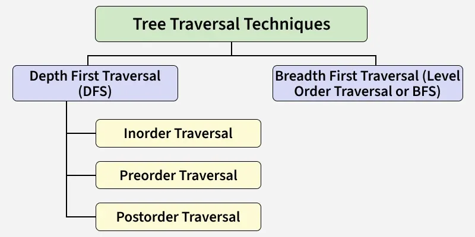

**Tree Construction from Inorder and Preorder Traversals**

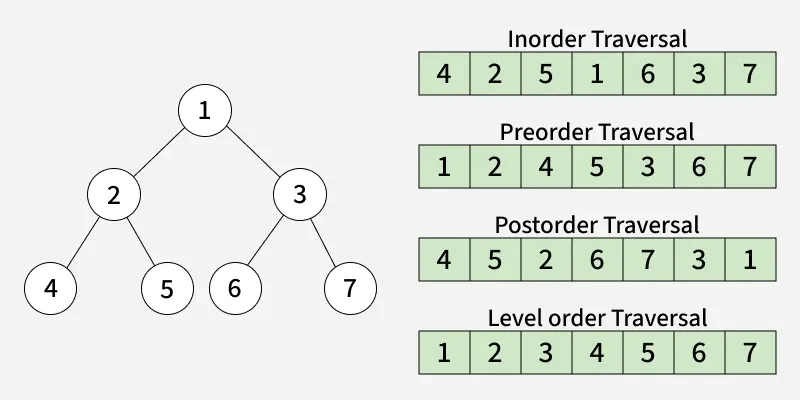

---

## Inorder Traversal

Inorder traversal visits the node in the order: **Left → Root → Right**

### Algorithm for Inorder Traversal

```
Inorder(tree)
1. Traverse the left subtree, i.e., call Inorder(left->subtree)
2. Visit the root.
3. Traverse the right subtree, i.e., call Inorder(right->subtree)
```

**Inorder Traversal – Slide 1 (Step 1)**

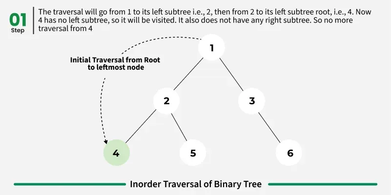

**Inorder Traversal – Slide 2 (Step 8)**

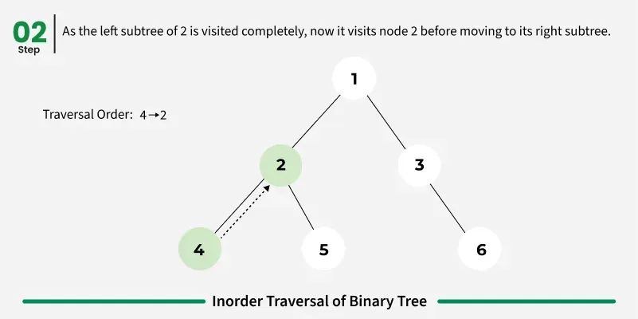

**Inorder Traversal – Slide 3 (Step 3)**

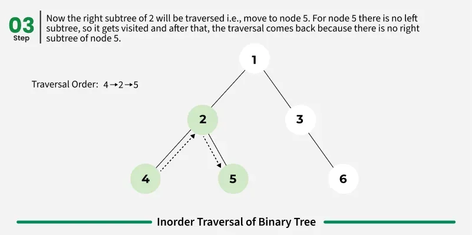

**Inorder Traversal – Slide 4 (Step 10)**

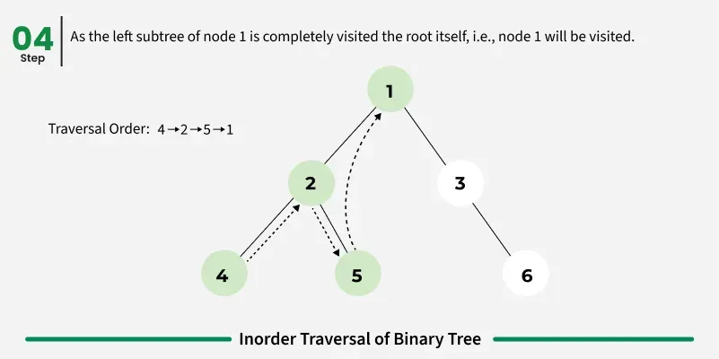

**Inorder Traversal – Slide 5 (Step 5)**

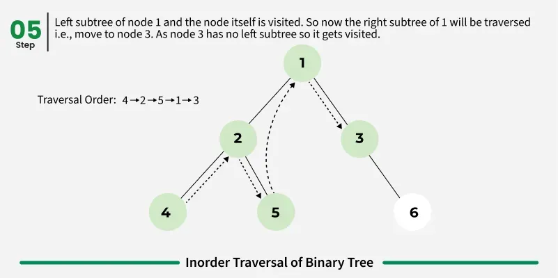

**Inorder Traversal – Slide 6 (Step 6)**

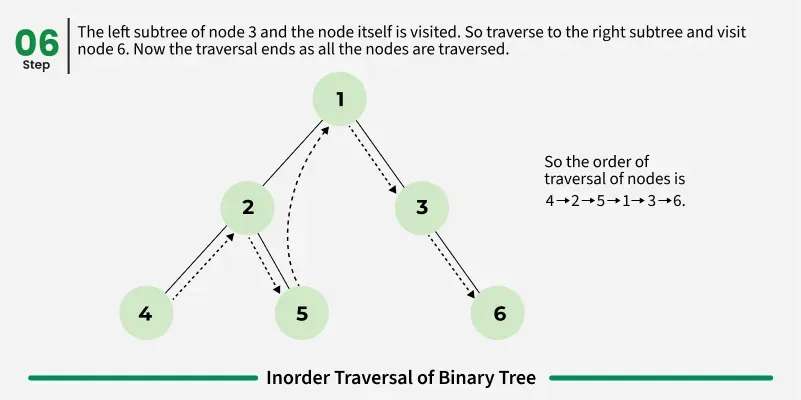

### Uses of Inorder Traversal

- In the case of binary search trees (BST), Inorder traversal gives nodes in non-decreasing order.
- To get nodes of BST in non-increasing order, a variation of Inorder traversal where Inorder traversal is reversed can be used.
- Inorder traversal can be used to evaluate arithmetic expressions stored in expression trees.

> **Also Check:** [Inorder Traversal of Binary Tree](https://www.geeksforgeeks.org/dsa/inorder-traversal-of-binary-tree/) for more.

---

## Preorder Traversal

Preorder traversal visits the node in the order: **Root → Left → Right**

### Algorithm for Preorder Traversal

```
Preorder(tree)
1. Visit the root.
2. Traverse the left subtree, i.e., call Preorder(left->subtree)
3. Traverse the right subtree, i.e., call Preorder(right->subtree)
```

**Preorder Traversal – Slide 1 (Step 1)**

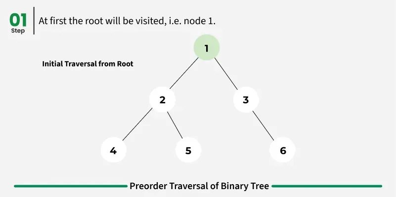

**Preorder Traversal – Slide 2 (Step 2)**

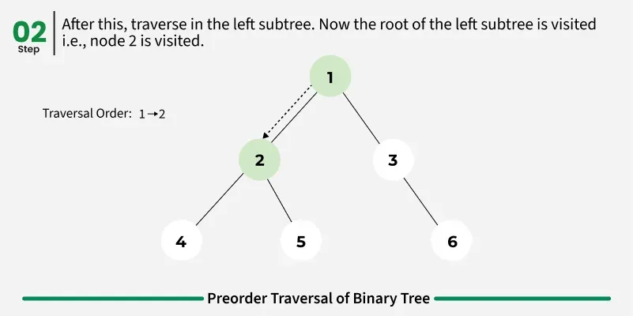

**Preorder Traversal – Slide 3 (Step 3)**

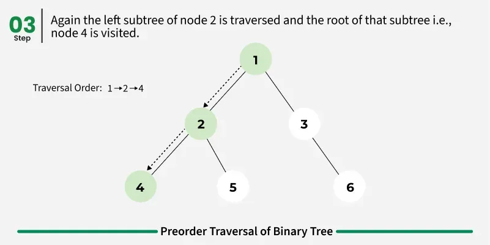

**Preorder Traversal – Slide 4 (Step 4)**

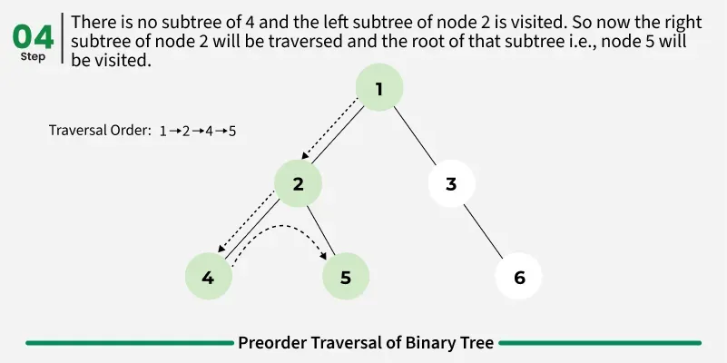

**Preorder Traversal – Slide 5 (Step 5)**

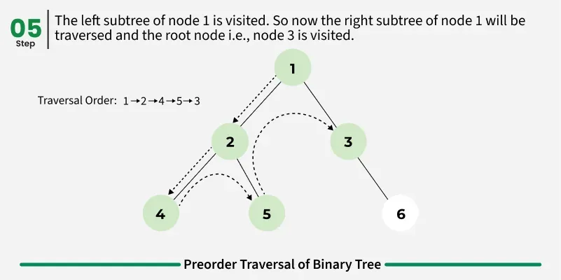

**Preorder Traversal – Slide 6 (Step 6)**

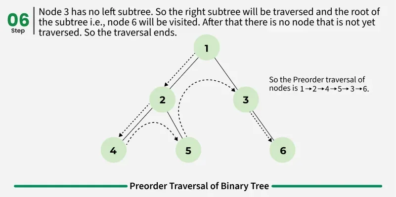

### Uses of Preorder Traversal

- Preorder traversal is used to create a copy of the tree.
- Preorder traversal is also used to get prefix expressions on an expression tree.

> **Also Check:** [Preorder Traversal of Binary Tree](https://www.geeksforgeeks.org/dsa/preorder-traversal-of-binary-tree/) for more.

---

## Postorder Traversal

Postorder traversal visits the node in the order: **Left → Right → Root**

### Algorithm for Postorder Traversal

```
Postorder(tree)
1. Traverse the left subtree, i.e., call Postorder(left->subtree)
2. Traverse the right subtree, i.e., call Postorder(right->subtree)
3. Visit the root.
```

**Postorder Traversal – Slide 1 (Step 1)**

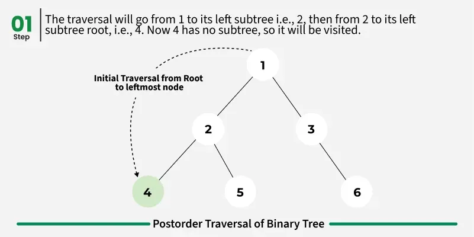

**Postorder Traversal – Slide 2 (Step 2)**

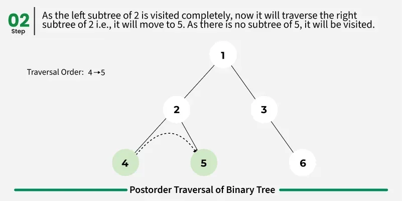

**Postorder Traversal – Slide 3 (Step 3)**

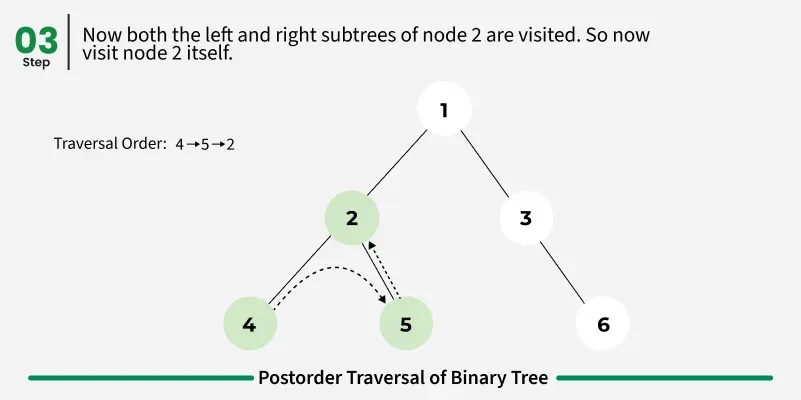

**Postorder Traversal – Slide 4 (Step 4)**

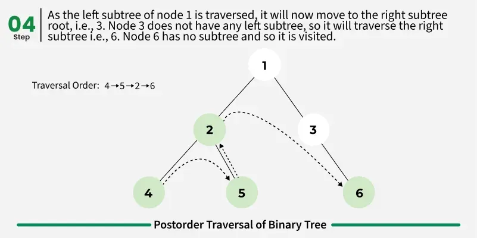

**Postorder Traversal – Slide 5 (Step 5)**

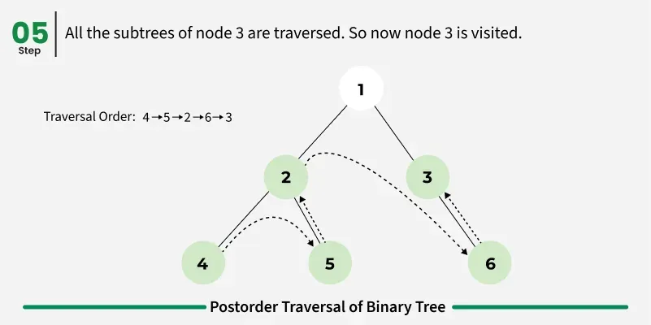

**Postorder Traversal – Slide 6 (Step 6)**

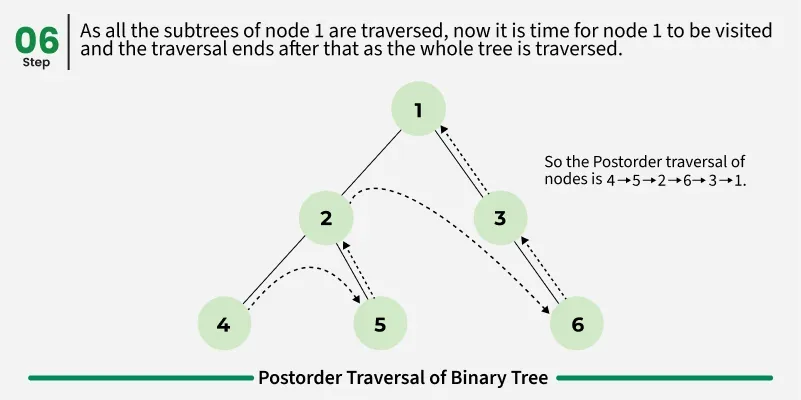

### Uses of Postorder Traversal

- Postorder traversal is used to delete the tree.
- Postorder traversal is also useful to get the postfix expression of an expression tree.
- Postorder traversal can help in garbage collection algorithms, particularly in systems where manual memory management is used.

> **Also Check:** [Postorder Traversal of Binary Tree](https://www.geeksforgeeks.org/dsa/postorder-traversal-of-binary-tree/) for more.

---

## Level Order Traversal

Level Order Traversal visits all nodes present in the same level completely before visiting the next level.

### Algorithm for Level Order Traversal

```
LevelOrder(tree)
1. Create an empty queue Q
2. Enqueue the root node of the tree to Q
3. Loop while Q is not empty:
   a. Dequeue a node from Q and visit it
   b. Enqueue the left child of the dequeued node if it exists
   c. Enqueue the right child of the dequeued node if it exists
```

**Level Order Traversal – Slide 1 (Step 1)**

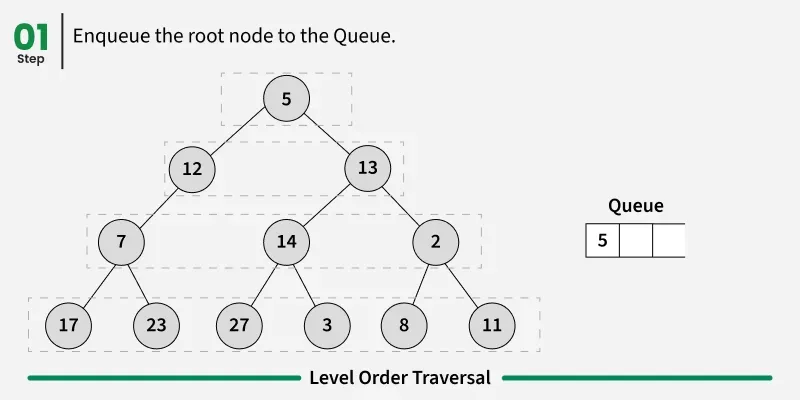

**Level Order Traversal – Slide 2 (Step 2)**

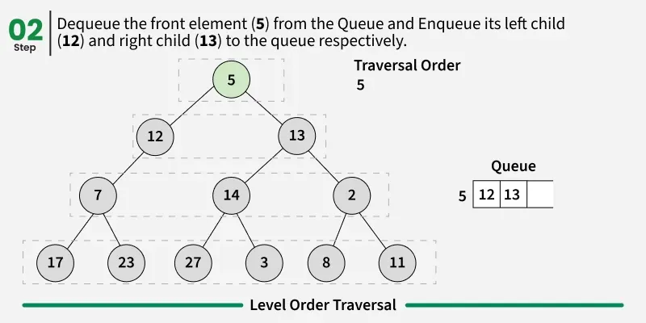

**Level Order Traversal – Slide 3 (Step 3)**

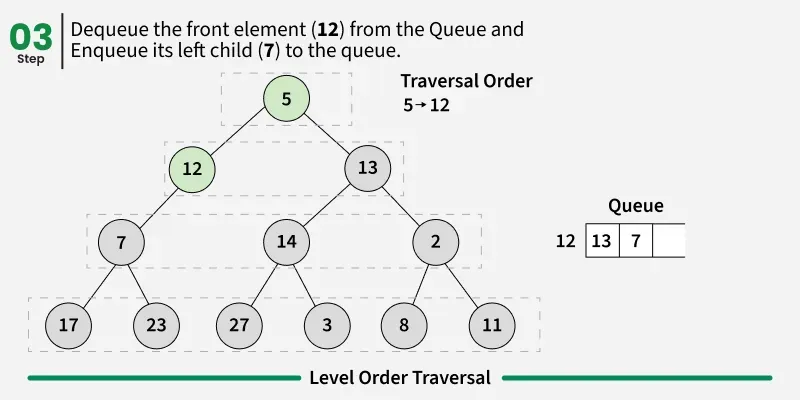

**Level Order Traversal – Slide 4 (Step 4)**

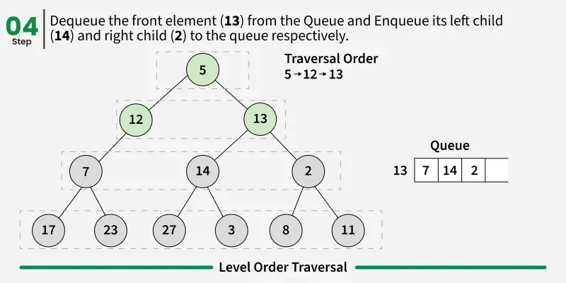

**Level Order Traversal – Slide 5 (Step 5)**

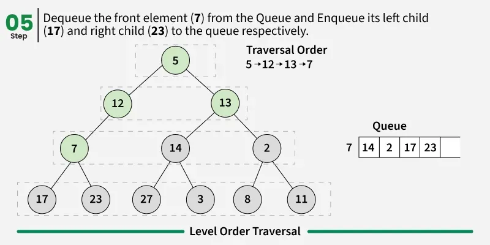

**Level Order Traversal – Slide 6 (Step 6)**

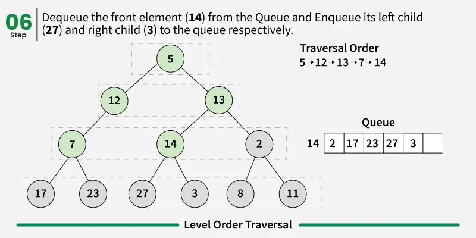

**Level Order Traversal – Slide 7 (Step 7)**

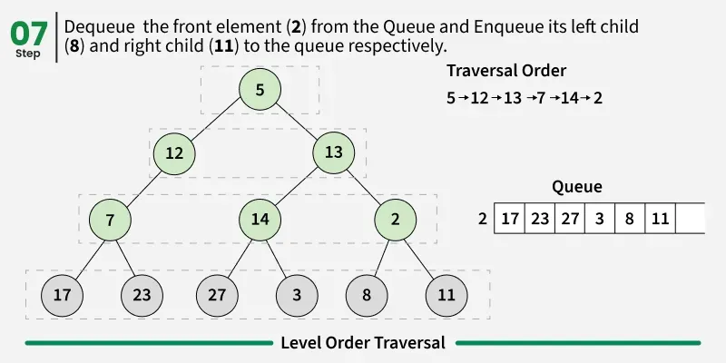

**Level Order Traversal – Slide 8 (Step 8)**

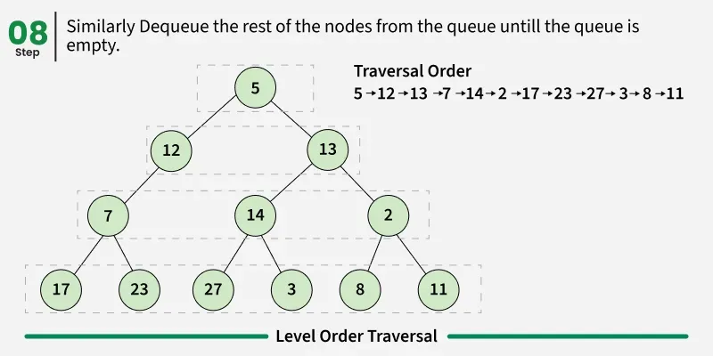

### Uses of Level Order Traversal

- Level-wise node processing, like finding maximum/minimum at each level.
- Tree serialization/deserialization for efficient storage and reconstruction.
- Solving problems like calculating the "maximum width of a tree" by processing nodes level by level.

---

## Other Tree Traversals

- **Boundary Traversal**
- **Diagonal Traversal**

### 1. Boundary Traversal

Boundary Traversal of a Tree includes:

- left boundary (nodes on left excluding leaf nodes)
- leaves (consist of only the leaf nodes)
- right boundary (nodes on right excluding leaf nodes)

**Boundary Traversal**

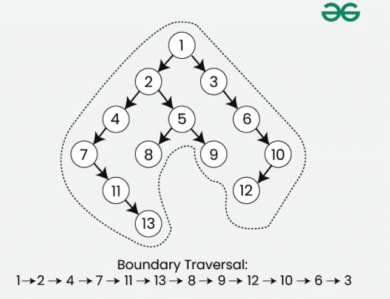

> **Also Check:** [Boundary Traversal of binary tree](https://www.geeksforgeeks.org/dsa/boundary-traversal-of-binary-tree/) for more.

### 2. Diagonal Traversal

In the Diagonal Traversal of a Tree, all the nodes in a single diagonal will be printed one by one.

**Diagonal Traversal**

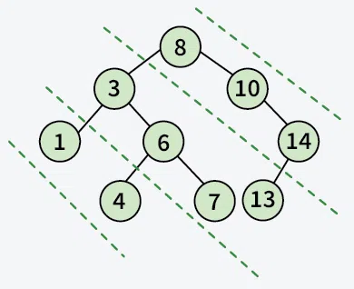

> **Also Check:** [Diagonal Traversal of Binary Tree](https://www.geeksforgeeks.org/dsa/diagonal-traversal-of-binary-tree/) for more.

---

## Related Articles

- [Tree Traversal](https://www.geeksforgeeks.org/dsa/tree-traversals-inorder-preorder-and-postorder/)
- [Inorder Traversal of Binary Tree](https://www.geeksforgeeks.org/dsa/inorder-traversal-of-binary-tree/)
- [Preorder Traversal in Python](https://www.geeksforgeeks.org/dsa/preorder-traversal-of-binary-tree/)
- [Postorder Traversal in Python](https://www.geeksforgeeks.org/dsa/postorder-traversal-of-binary-tree/)

---
